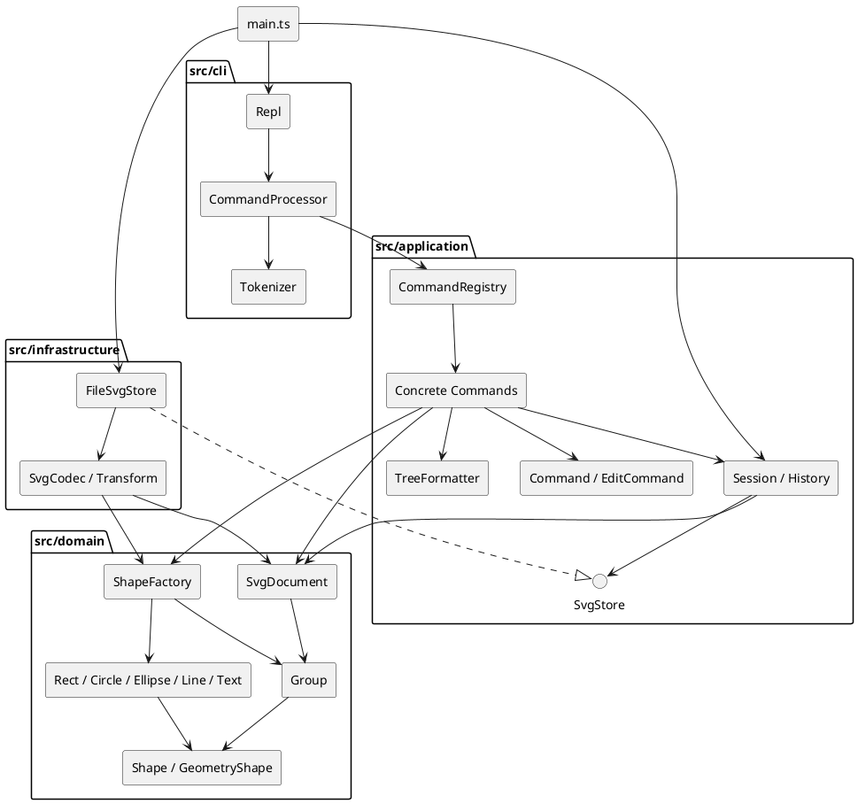

# Lab1 Phase 1：SVG 编辑器（CLI）

Git 仓库：[https://github.com/by088/-](https://github.com/by088/-)。

克隆地址：`https://github.com/by088/-.git`。

## 项目说明与运行

本项目实现六种内置类型 `rect / circle / ellipse / line / text / g`、19 个命令、SVG 文件读写和一条编辑命令一个撤销单元。`box` 创建及插件加载属于后续阶段，当前报未知类型。

环境：Node.js ≥ 20，npm。运行时 XML 依赖为 `@xmldom/xmldom`，开发依赖为 TypeScript、tsx 与 Node 类型声明；确切版本由 `package-lock.json` 固定。

在工程根目录执行：

```sh
npm ci
npm run cli
```

若本机 npm 镜像无法解析，可显式使用 `npm ci --registry=https://registry.npmjs.org`。

交互界面使用 `svg>` 提示符；Ctrl-D 结束输入。脚本模式不输出提示符，支持空行、CRLF 和以 `#` 开头的整行注释；发生错误继续处理下一行，结束时返回非零退出码。颜色中的 `#` 不被当成注释。不支持行尾注释。

```sh
npm run --silent cli < examples/flowchart.commands
npm run build
node dist/main.js
```

`examples/flowchart.commands` 是可执行的流程图案例，运行后生成 `examples/flowchart.svg`。浏览器直接打开 SVG 即可预览。`examples/other.svg` 展示外部文件导入时的自动补 ID 行为。

## 架构方案

### 1. 模块划分

```text
src/
├── main.ts                 组合根：选择适配器、创建会话并启动 REPL
├── cli/                    输入分词、交互/脚本循环、统一错误输出
├── application/
│   ├── commands/           19 个具体命令，各自独立文件
│   ├── Command.ts          命令抽象
│   ├── EditCommand.ts      编辑事务与快照撤销
│   ├── History.ts          undo/redo 两个栈和 IO 屏障
│   ├── Session.ts          当前文档、路径及应用上下文
│   ├── SvgStore.ts         文件读写端口
│   ├── CommandRegistry.ts  命令工厂
│   └── TreeFormatter.ts    结构树、属性明细展示
├── domain/                 图形类层次、几何验证、树结构与重组规则
└── infrastructure/         XML 编解码、变换规范化、真实文件系统

test/                       功能、文件读写、CLI 与架构检查
examples/                   可回放命令与 SVG 示例
doc/                        本文与 PlantUML 源码
```

| 模块 | 职责与边界 |
|---|---|
| `domain` | `Shape` 封装身份、样式与属性校验；`GeometryShape` 封装几何状态；六个具体类实现多态行为；`Group` 管理子节点；`SvgDocument` 维护唯一 ID、归属和顺序。不认识 CLI、磁盘或 XML 库。 |
| `application` | 命令对象表达用例，`EditCommand` 控制成功提交，`History` 管理历史，`Session` 保存当前文档/路径，`SvgStore` 声明存储能力。 |
| `cli` | `Tokenizer` 处理引号和转义；`CommandProcessor` 执行命令并把错误转为一行 `error:`；`Repl` 负责流与提示符。 |
| `infrastructure` | `SvgCodec` 把 XML 转为领域对象并序列化；`Transform` 解析支持的 SVG 变换；`FileSvgStore` 处理文件错误和临时文件替换。 |
| `main.ts` | 唯一装配入口，连接抽象端口与具体实现。 |

PlantUML 组件图如下；同内容可从 [architecture.puml](architecture.puml) 渲染。本项目不要求在运行时安装 PlantUML。



### 2. 设计模式及代码落地

**Command**：`Command` 定义执行协议，每种命令对应一个类，如 `MoveCommand`、`GroupCommand`。命令分发只创建对象，业务通过多态调用 `execute()`。编辑命令继承 `EditCommand`，具体类只实现 `apply(document)`；文档类、显示类与历史类直接继承 `Command`，不会意外进入编辑历史。

**Composite**：`Shape` 提供统一的 `move / scale / set / clone / children` 接口。叶子图形在自身封装的几何字段上变换，`Group` 将移动与缩放递归作用于子节点。`MoveCommand` 和 `ScaleCommand` 不判断图形标签。容器 `set fill` 等设置 SVG 可继承属性，序列化后由 SVG 的继承规则作用于没有显式覆盖的后代。删除在文档层统一摘除任意节点，容器自然携带整棵子树。

**Memento（快照）**：每个成功的 `EditCommand` 保存修改前后两个深拷贝。撤销/重做从快照恢复，再次深拷贝避免后续编辑污染历史。分组即使涉及多个原父容器，仍只对应一个历史条目。选择快照是因为阶段一数据量小，而树重组的逆操作容易遗漏原索引、父级或样式；未来大文档可替换为差量记录。当前时间与空间成本随文档大小和历史长度增长，不声称适合无限历史或超大 SVG。

**Factory**：`ShapeFactory` 是图形类型名到构造器的唯一分发点，也被 SVG 读入复用。`CommandRegistry` 是命令名到命令对象的唯一分发点。两处均使用映射而非在各处重复 `switch(tag)`。

**端口与适配器**：应用定义 `SvgStore`，`FileSvgStore` 实现它。文件系统和 XML 库被隔离，可在后续替换存储介质或解析库。

**待重构项**：`ShapeFactory` 和 `CommandRegistry` 的内置映射目前写在构造函数中；后续插件阶段应改为显式注册、处理重名冲突并定义生命周期。这是目前仅有的图形类型/命令名称分派位置。属性白名单校验、词法解析和 transform 语法解析不负责图形类型分派。尚未实现 `ShapeProvider` 插件接口，不能宣称现在新增 `box` 已经做到内核零修改。

### 3. 依赖方向规则

| 发起模块 | 允许依赖 | 理由 |
|---|---|---|
| `domain` | 自身 | 保持业务语义不依赖输入、存储、框架。 |
| `application` | 自身、`domain` | 用例调用领域行为，存储依赖本层定义的接口。 |
| `cli` | 自身、`application`、Node 流/终端 API | CLI 负责输入输出，不直接编辑领域树或访问 XML。 |
| `infrastructure` | 自身、`application` 的存储端口、`domain`、Node 文件 API、XML 库 | 实现端口并完成外部表示与领域模型间的转换。 |
| `main.ts` | 所有生产模块 | 组合根允许装配所有依赖。 |
| `test` | 被测模块、Node 测试工具 | 独立验证功能与架构，不被生产模块引用。 |

`application` 通过 `SvgStore` 端口使用存储能力，由 `main.ts` 注入具体适配器；`domain` 不依赖应用层、CLI 或基础设施；`cli` 通过应用层命令执行业务操作。

`application → infrastructure`、`domain → application/cli/infrastructure`、`cli → domain/infrastructure` 均不允许。发现这类导入时应调整接口或移动职责，不能通过修改规则消除问题。

### 4. 变化点假设

| 可能变化 | 当前准备 / 决定不提前实现的原因 |
|---|---|
| 增加 `box` 等复合图形与插件 | 保留统一 Shape 协议和集中工厂；暂不实现插件加载器，避免将后续阶段需求混进 Phase 1。 |
| 新增命令或接入 GUI/agent | 用例已在命令类中，独立于终端；新入口可复用 Command、Session 和 History。 |
| 更换 XML 库、文件来源或云存储 | 依赖 `SvgStore`；XML 细节只在基础设施内。 |
| 大文档与长历史 | 快照策略集中在 `EditCommand`；未来引入差量 Memento、容量限制和 ID 索引。当前搜索/唯一性检查采用树遍历，优先可读性与正确性。 |
| 输出格式、国际化 | 显示集中在 `TreeFormatter`，提示主要位于具体命令。未建立本阶段用不到的翻译框架。 |
| 支持更完整的 SVG/CSS/变换 | `SvgCodec` 与 `Transform` 隔离导入限制；无法支持的可视结构明确报错，避免静默损失。 |

## 过程记录

项目使用 Codex 协作完成。以下记录围绕实现中的关键决策及后续复核，依据代码、已有开发历史和实际运行结果整理。

1. **先确定边界，再组织实现。** 开发历史先建立 TypeScript 工程和四层方案，再实现领域模型，随后接入命令、CLI 和存储适配器，最后补充测试与文档。将 `box` 留在后续插件阶段，避免把尚未实现的插件能力写成当前功能。
2. **确定编辑失败的处理方式。** 分组会同时修改多个父容器，递归缩放也可能在后续子节点溢出。复核 `EditCommand.execute()` 时确认，操作先作用于文档副本，全部成功后才替换会话文档并记录历史；测试用后续子节点溢出的情况检查前面节点也不会留下部分修改。
3. **核对外部 SVG 的 ID 分配。** 直接给第一个未命名矩形分配 `rect1`，可能与文件后面显式声明的 `rect1` 冲突。现有 `SvgCodec` 先遍历并保留所有显式 ID，再分配缺失 ID；对应测试覆盖该冲突场景、重复 ID 和警告内容。
4. **明确容器和叶子的统一操作。** 检查命令与图形模型后，保留 `Shape` 的多态协议：移动和缩放由 `Group` 递归调用子节点，命令无需按标签判断图形；普通组样式通过 SVG 继承规则生效。`ungroup` 保留组中可继承的样式，避免解组后外观无故变化。
5. **核对保存再读回的语义。** 检查不只比较生成的 XML 文本，还比较图形属性、层级、顺序与文本内容。现有用例覆盖 Unicode、XML 转义、自动 ID、根 ID 和嵌套变换；不支持的 SVG 结构明确拒绝，避免静默丢失内容。
6. **运行并核对结果。** 在 Windows、Node.js 24.15.0 环境下执行严格编译和现有测试，结果为 39 项全部通过；另已回放流程图脚本，生成包含 8 个元素的 SVG。根据这些结果描述已实现范围，不把未做的浏览器视觉比对或性能测量写成已完成。

## 一致性自查

### 1. 模块划分

实际目录与方案一致：`cli`、`application`、`domain`、`infrastructure` 对应四层职责，`main.ts` 负责装配。`application/commands` 是应用层内部的细分；`Transform` 位于基础设施层，负责 SVG 导入变换，均未改变依赖边界。

生产类使用独立文件，文件名与类名一致。图形身份、样式、几何状态、组内节点和历史栈由类封装；图形类同时承担变换、属性校验和复制行为。没有用公共数据袋配合按标签分派的过程式函数代替图形模型。

当前目录没有需要另行记录的架构偏离。两个名称映射仍是已在方案中标明的后续重构项。

### 2. 依赖方向

按源码导入关系抽查如下：

| 源码位置 | 实际依赖 | 与方案的对应关系 |
|---|---|---|
| `application/commands/MoveCommand.ts` | `EditCommand`、`SvgDocument`、`Value` | 应用层依赖自身和领域层。 |
| `application/Session.ts` | `History`、`SvgStore`、`SvgDocument`、`EditorError` | 会话依赖存储端口，不依赖文件适配器。 |
| `domain/Group.ts` | `Shape`、`Value`、`EditorError` | 领域层依赖内部类型。 |
| `cli/CommandProcessor.ts` | `CommandRegistry`、`Session`、`Tokenizer` | CLI 通过应用层执行业务，不直接依赖领域树或 XML。 |
| `infrastructure/FileSvgStore.ts` | `SvgStore`、`SvgCodec`、`SvgDocument` 与 Node API | 基础设施实现应用层端口，并负责外部 IO。 |

上述抽查未发现违规依赖。架构检查还辅助检查一类一文件及源码中的 `switch`；跨层规则仍结合源码审阅判断。现有架构测试按 `/` 拆分路径，在 Windows 上存在反斜杠路径识别不足，因此不能仅凭该测试通过就认定所有依赖均已检查；其路径处理是待完善项。

## 质量保证手段

### 功能完整性

将命令和关键状态转换对应到可运行用例，而不是只检查程序能否启动。

| 范围 | 检查内容 | 对应文件 |
|---|---|---|
| 六种图形与编辑 | 创建、显式父容器、属性白名单、默认样式、移动、缩放、删除 | `test/editor.test.ts` |
| 组合结构 | 嵌套操作、分组顺序、跨父级分组、环检查、解组、z-order | `test/editor.test.ts` |
| 撤销重做与失败处理 | 一条编辑一个单元、IO 屏障、新编辑清空 redo、失败不改变文档及历史 | `test/editor.test.ts` |
| SVG 读写 | 自动 ID、重复 ID、转义、Unicode、嵌套变换、保存再读回、真实文件读写失败 | `test/svg.test.ts` |
| 命令行 | 引号与转义、注释、提示符、CRLF、错误后继续执行、退出码 | `test/cli.test.ts` |
| 代码组织 | 一类一文件、类名与文件名、名称分派及依赖检查 | `test/architecture.test.ts`，结合源码抽查 |

### 已执行结果与复现方式

已执行 `npm run check`，TypeScript 严格编译成功，测试结果为 **39 tests / 39 pass / 0 fail**。已运行流程图脚本，生成 `examples/flowchart.svg`，包含两组节点及连接线，共 8 个元素。

在工程目录可复现编译和测试：

```sh
npm ci
npm run check
```

在 Windows PowerShell 中回放示例：

```powershell
Get-Content -Encoding utf8 examples/flowchart.commands | npm run --silent cli
```

在支持输入重定向的终端中也可使用：

```sh
npm run --silent cli < examples/flowchart.commands
```

### 质量依据与限制

对状态正确性的信心主要来自事务副本、深拷贝历史、参数校验以及覆盖失败路径的用例；对结构的检查来自模块职责、明确的依赖规则和源码抽查。测试还包含多次混合编辑后的逐步撤销与重放，用于检查历史状态是否被后续操作污染。

目前未做跨浏览器像素比对、超大文档性能压测或完整 SVG 标准兼容性验证。快照历史的时间和空间开销随文档规模与历史长度增长；支持的 SVG 子集及已知限制见下文。这些边界不能由 39 项测试通过推导为已经解决。

## 行为约定与阶段边界

### 命令覆盖

| 类别 | 命令 |
|---|---|
| 文档 | `init [w] [h]`、`read <file.svg>`、`save [file.svg]`、`canvas [w h]` |
| 编辑 | `create`、`delete`、`move`、`scale`、`set`、`group`、`ungroup`、`addto`、`front`、`back` |
| 显示 | `tree [id]`、`show <id>`、`help` |
| 历史 | `undo`、`redo` |

`create` 类型参数如下；所有类型均支持末尾 `in <containerId>`，省略则加入画布根。

```text
create rect <id> <x> <y> <w> <h> [fill]
create circle <id> <cx> <cy> <r> [fill]
create ellipse <id> <cx> <cy> <rx> <ry> [fill]
create line <id> <x1> <y1> <x2> <y2> [stroke]
create text <id> <x> <y> "content"
create g <id>
```

`fill / stroke` 省略时不写入，遵循 SVG 原生默认值。`set` 仅允许公共 `fill / stroke / stroke-width`、对应图形的几何字段，以及文字的 `text`；不允许修改 `id`。文字中的双引号、反斜杠及换行/制表可分别使用 `\"`、`\\`、`\n`、`\t`；空内容使用 `""`。

### 主要操作语义

- ID 唯一且大小写敏感；拒绝空 ID、空白和不适合作为 ID 的引号/尖括号等字符。读入时预扫描所有显式 ID，然后从 `标签1` 开始补号并避开现有 ID，成功导入后才输出警告。外部根 `<svg>` 的 ID 保留并占用名称，但根不是可编辑图形。
- `init` 默认为 800×600；只给宽度时高度默认 600。`canvas` 查询无需参数，修改必须同时给宽、高；画布宽高必须为有限正数。
- 几何位置允许负数和小数；尺寸、半径及描边宽度允许零但不能为负数；拒绝 NaN、Infinity 及运算溢出。`scale` 的因子严格为正，作用于所有几何位置和尺寸，不修改描边宽度或文本字号。
- 同父级 `group` 在第一个被选节点的位置插入新组，组内按原文档顺序排列。跨父级选择以最近共同祖先为父级，在第一个涉及的分支前插入，组内按原文档深度优先顺序排列。参数顺序不反转绘制顺序。不允许重复选择、祖先和后代同时入组，或移动节点到其自身/后代。
- `ungroup` 将子节点放回原组所在位置，保留继承自被解散组的样式；显式子样式优先。依照题目规定，拒绝解散直接位于 `<svg>` 下的顶层组，即使通常的图形软件允许此操作。
- `front` 移到同级列表末端（最后绘制、视觉最前）；`back` 移到列表开头。`addto` 总是追加到目标组最后，包括在同一父级内重排。
- 成功执行 `init/read/save/canvas 修改` 清空两个历史栈并设立 IO 屏障，undo 和 redo 均输出题目规定的 `undo not allowed after io command`。下一次成功编辑解除屏障。失败命令不影响文档、路径、undo 或 redo；显示命令和 canvas 查询不影响历史。
- `save <path>` 成功后该路径成为当前路径，后续 `save` 可复用；`init` 清除路径。保存采用同目录临时文件加 rename；写入失败清理临时文件。错误统一一行 `error:`，文件错误包含原请求路径。
- undo/redo 回显采用 `undone:` / `redone:` 加原编辑摘要；状态精确恢复。树展示使用 Unicode 分支符并内联几何属性。

### SVG 读写范围

内置六种元素支持嵌套、颜色、描边、Unicode、XML 转义、文本节点和 CDATA。读入支持 SVG 命名空间及其前缀形式，也接受无命名空间的简单 SVG。画布支持数字或 `px` 尺寸和有效 viewBox；省略画布尺寸时优先使用 viewBox 的宽高，否则采用 800×600。图形几何字段接受无单位数值，缺省字段取 0。

除 set 白名单外，读写保留 `opacity`、`fill-opacity`、`stroke-opacity`、`font-size`、`font-family`、`font-weight`、`text-anchor`、`dominant-baseline`、`stroke-linecap`、`stroke-linejoin` 与 `data-*` 属性。这些导入扩展属性不因此成为可 set 的属性。`data-kind="box"` 降级成普通 `g`，保留标记和内部图形。

支持 `translate` 与正数等比 `scale` 的组合/嵌套；导入时合成为世界坐标，不保留原 transform 字符串。变换导入还会将有效数值/px 描边宽度、字号折算到叶子，保持支持范围内的外观；这与 CLI 的几何缩放命令是两个不同操作。

暂不支持 `path/use/image/defs/tspan`、CSS/style、旋转、非等比缩放、百分比尺寸、DTD/实体声明等；遇到未支持的元素、属性或变换会拒绝整次读入。注释和 XML 格式缩进不参与编辑模型，不保证字节级原样保存。组整体 opacity 不能无损下放为子节点 opacity，因此额外拒绝解散含非 1 opacity 的导入组。这个边界不影响题目规定的 create/set 所能构造的普通组。
