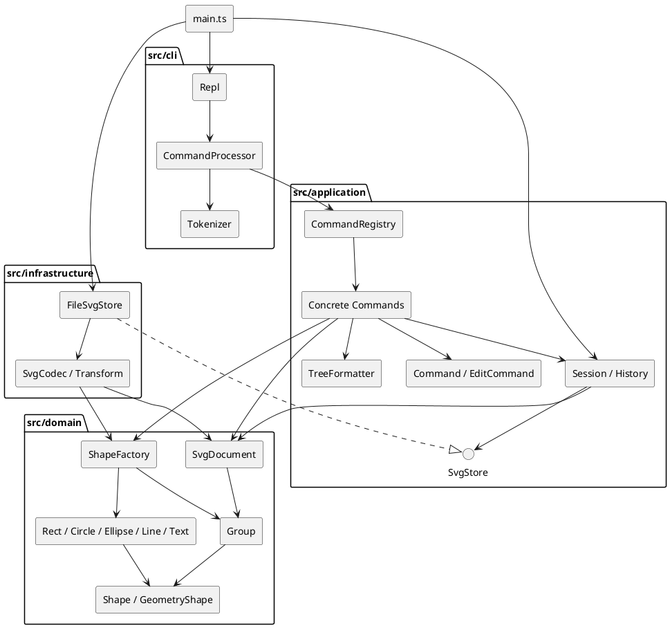

# Lab1 Phase 1：SVG 编辑器（CLI）

## 项目说明与运行

本项目实现任务文档的 Phase 1：六种内置类型 `rect / circle / ellipse / line / text / g`，全部 19 个命令，SVG 文件读写和一条编辑命令一个撤销单元。`box` 创建及插件加载属于后续阶段，本阶段明确报未知类型。

环境：Node.js ≥ 20，npm。开发验证使用 Node.js 20.18.3。运行时 XML 依赖为 `@xmldom/xmldom`，开发依赖为 TypeScript、tsx 与 Node 类型声明；确切版本由 `package-lock.json` 固定。

在工程根目录执行：

```sh
npm ci
npm run cli
```

若本机 npm 镜像无法解析，可显式使用 `npm ci --registry=https://registry.npmjs.org`。

交互界面使用 `svg>` 提示符；Ctrl-D 结束输入。脚本模式不输出提示符，支持空行、CRLF 和以 `#` 开头的整行注释；发生错误继续处理下一行，结束时返回非零退出码。颜色中的 `#` 不被当成注释。不支持行尾注释。

```sh
npm run check
npm run --silent cli < examples/flowchart.commands
npm run build
node dist/main.js
```

`examples/flowchart.commands` 是任务中版本 A 的完整可执行流程图案例，运行后生成 `examples/flowchart.svg`。浏览器直接打开 SVG 即可预览。另有 `examples/other.svg` 用于验证外部文件自动补 ID。

## 架构方案

### 1. 模块划分

```text
src/
├── main.ts                 组合根：选择适配器、创建会话并启动 REPL
├── cli/                    输入分词、交互/脚本循环、统一错误输出
├── application/
│   ├── commands/           19 个具体命令，各自独立文件
│   ├── Command.ts          命令抽象
│   ├── EditCommand.ts      编辑事务与快照撤销
│   ├── History.ts          undo/redo 两个栈和 IO 屏障
│   ├── Session.ts          当前文档、路径及应用上下文
│   ├── SvgStore.ts         文件读写端口
│   ├── CommandRegistry.ts  命令工厂
│   └── TreeFormatter.ts    结构树、属性明细展示
├── domain/                 图形类层次、几何验证、树结构与重组规则
└── infrastructure/         XML 编解码、变换规范化、真实文件系统

test/                       功能、集成、架构验收
examples/                   可回放命令与 SVG 示例
doc/                        本文与 PlantUML 源码
```

| 模块 | 职责与边界 |
|---|---|
| `domain` | `Shape` 封装身份、样式与属性校验；`GeometryShape` 封装几何状态；六个具体类实现多态行为；`Group` 管理子节点；`SvgDocument` 维护唯一 ID、归属和顺序。不认识 CLI、磁盘或 XML 库。 |
| `application` | 命令对象表达用例，`EditCommand` 控制成功提交，`History` 管理历史，`Session` 保存当前文档/路径，`SvgStore` 声明存储能力。 |
| `cli` | `Tokenizer` 处理引号和转义；`CommandProcessor` 执行命令并把错误转为一行 `error:`；`Repl` 负责流与提示符。 |
| `infrastructure` | `SvgCodec` 把 XML 转为领域对象并序列化；`Transform` 解析支持的 SVG 变换；`FileSvgStore` 处理文件错误和临时文件替换。 |
| `main.ts` | 唯一装配入口，连接抽象端口与具体实现。 |

PlantUML 组件图如下；同内容可从 [architecture.puml](architecture.puml) 渲染。本项目不要求在运行时安装 PlantUML。



### 2. 设计模式及代码落地

**Command（必选）**：`Command` 定义执行协议，每种命令对应一个类，如 `MoveCommand`、`GroupCommand`。命令分发只创建对象，业务通过多态调用 `execute()`。编辑命令继承 `EditCommand`，具体类只实现 `apply(document)`；文档类、显示类与历史类直接继承 `Command`，不会意外进入编辑历史。

**Composite**：`Shape` 提供统一的 `move / scale / set / clone / children` 接口。叶子图形在自身封装的几何字段上变换，`Group` 将移动与缩放递归作用于子节点。`MoveCommand` 和 `ScaleCommand` 不判断图形标签。容器 `set fill` 等设置 SVG 可继承属性，序列化后由 SVG 的继承规则作用于没有显式覆盖的后代。删除在文档层统一摘除任意节点，容器自然携带整棵子树。

**Memento（快照）**：每个成功的 `EditCommand` 保存修改前后两个深拷贝。撤销/重做从快照恢复，再次深拷贝避免后续编辑污染历史。分组即使涉及多个原父容器，仍只对应一个历史条目。选择快照是因为阶段一数据量小，而树重组的逆操作容易遗漏原索引、父级或样式；未来大文档可替换为差量记录。当前时间与空间成本随文档大小和历史长度增长，不声称适合无限历史或超大 SVG。

**Factory**：`ShapeFactory` 是图形类型名到构造器的唯一分发点，也被 SVG 读入复用。`CommandRegistry` 是命令名到命令对象的唯一分发点。两处均使用映射而非在各处重复 `switch(tag)`。

**端口与适配器**：应用定义 `SvgStore`，`FileSvgStore` 实现它。文件系统和 XML 库被隔离，可在后续替换存储介质或解析库。

**待重构项**：`ShapeFactory` 和 `CommandRegistry` 的内置映射目前写在构造函数中；后续插件阶段应改为显式注册、处理重名冲突并定义生命周期。这是目前仅有的图形类型/命令名称分派位置。属性白名单校验、词法解析和 transform 语法解析不负责图形类型分派。尚未实现 `ShapeProvider` 插件接口，不能宣称现在新增 `box` 已经做到内核零修改。

### 3. 依赖方向规则

| 发起模块 | 允许依赖 | 理由 |
|---|---|---|
| `domain` | 自身 | 保持业务语义不依赖输入、存储、框架。 |
| `application` | 自身、`domain` | 用例调用领域行为，存储依赖本层定义的接口。 |
| `cli` | 自身、`application`、Node 流/终端 API | CLI 负责输入输出，不直接编辑领域树或访问 XML。 |
| `infrastructure` | 自身、`application` 的存储端口、`domain`、Node 文件 API、XML 库 | 实现端口并完成外部表示与领域模型间的转换。 |
| `main.ts` | 所有生产模块 | 组合根允许装配所有依赖。 |
| `test` | 被测模块、Node 测试工具 | 测试是独立的验证入口，不被生产代码引用。 |

`application → infrastructure`、`domain → application/cli/infrastructure`、`cli → domain/infrastructure` 均属于违规依赖。架构测试扫描相对导入，验证模块层级，并检查领域层/应用层没有第三方或 Node API 导入；另检查每个文件最多一个导出类，类名与文件名一致。对于基础设施对应用层的依赖，测试检查到模块级别，接口级限制仍需审阅。

### 4. 变化点假设

| 可能变化 | 当前准备 / 决定不提前实现的原因 |
|---|---|
| 增加 `box` 等复合图形与插件 | 保留统一 Shape 协议和集中工厂；暂不实现插件加载器，避免将后续阶段需求混进 Phase 1。 |
| 新增命令或接入 GUI/agent | 用例已在命令类中，独立于终端；新入口可复用 Command、Session 和 History。 |
| 更换 XML 库、文件来源或云存储 | 依赖 `SvgStore`；XML 细节只在基础设施内。 |
| 大文档与长历史 | 快照策略集中在 `EditCommand`；未来引入差量 Memento、容量限制和 ID 索引。当前搜索/唯一性检查采用树遍历，优先可读性与正确性。 |
| 输出格式、国际化 | 显示集中在 `TreeFormatter`，提示主要位于具体命令。未建立本阶段用不到的翻译框架。 |
| 支持更完整的 SVG/CSS/变换 | `SvgCodec` 与 `Transform` 隔离导入限制；无法支持的可视结构明确报错，避免静默损失。 |

## 行为约定与阶段边界

### 命令覆盖

| 类别 | 命令 |
|---|---|
| 文档 | `init [w] [h]`、`read <file.svg>`、`save [file.svg]`、`canvas [w h]` |
| 编辑 | `create`、`delete`、`move`、`scale`、`set`、`group`、`ungroup`、`addto`、`front`、`back` |
| 显示 | `tree [id]`、`show <id>`、`help` |
| 历史 | `undo`、`redo` |

`create` 类型参数如下；所有类型均支持末尾 `in <containerId>`，省略则加入画布根。

```text
create rect <id> <x> <y> <w> <h> [fill]
create circle <id> <cx> <cy> <r> [fill]
create ellipse <id> <cx> <cy> <rx> <ry> [fill]
create line <id> <x1> <y1> <x2> <y2> [stroke]
create text <id> <x> <y> "content"
create g <id>
```

`fill / stroke` 省略时不写入，遵循 SVG 原生默认值。`set` 仅允许公共 `fill / stroke / stroke-width`、对应图形的几何字段，以及文字的 `text`；不允许修改 `id`。文字中的双引号、反斜杠及换行/制表可分别使用 `\"`、`\\`、`\n`、`\t`；空内容使用 `""`。

### 对需求中未完全指定行为的明确选择

- ID 唯一且大小写敏感；拒绝空 ID、空白和不适合作为 ID 的引号/尖括号等字符。读入时预扫描所有显式 ID，然后从 `标签1` 开始补号并避开现有 ID，成功导入后才输出警告。外部根 `<svg>` 的 ID 保留并占用名称，但根不是可编辑图形。
- `init` 默认为 800×600；只给宽度时高度默认 600。`canvas` 查询无需参数，修改必须同时给宽、高；画布宽高必须为有限正数。
- 几何位置允许负数和小数；尺寸、半径及描边宽度允许零但不能为负数；拒绝 NaN、Infinity 及运算溢出。`scale` 的因子严格为正，作用于所有几何位置和尺寸，不修改描边宽度或文本字号。
- 同父级 `group` 在第一个被选节点的位置插入新组，组内按原文档顺序排列。跨父级选择以最近共同祖先为父级，在第一个涉及的分支前插入，组内按原文档深度优先顺序排列。参数顺序不反转绘制顺序。不允许重复选择、祖先和后代同时入组，或移动节点到其自身/后代。
- `ungroup` 将子节点放回原组所在位置，保留继承自被解散组的样式；显式子样式优先。依照题目规定，拒绝解散直接位于 `<svg>` 下的顶层组，即使通常的图形软件允许此操作。
- `front` 移到同级列表末端（最后绘制、视觉最前）；`back` 移到列表开头。`addto` 总是追加到目标组最后，包括在同一父级内重排。
- 成功执行 `init/read/save/canvas 修改` 清空两个历史栈并设立 IO 屏障，undo 和 redo 均输出题目规定的 `undo not allowed after io command`。下一次成功编辑解除屏障。失败命令不影响文档、路径、undo 或 redo；显示命令和 canvas 查询不影响历史。
- `save <path>` 成功后该路径成为当前路径，后续 `save` 可复用；`init` 清除路径。保存采用同目录临时文件加 rename；写入失败清理临时文件。错误统一一行 `error:`，文件错误包含原请求路径。
- undo/redo 回显采用 `undone:` / `redone:` 加原编辑摘要；状态精确恢复。树展示使用 Unicode 分支符，内联几何属性，列间空格不要求逐字符复刻题目示例。

### SVG 读写范围

内置六种元素支持嵌套、颜色、描边、Unicode、XML 转义、文本节点和 CDATA。读入支持 SVG 命名空间及其前缀形式，也接受无命名空间的简单 SVG。画布支持数字或 `px` 尺寸和有效 viewBox；省略画布尺寸时优先使用 viewBox 的宽高，否则采用 800×600。图形几何字段接受无单位数值，缺省字段取 0。

除 set 白名单外，读写保留 `opacity`、`fill-opacity`、`stroke-opacity`、`font-size`、`font-family`、`font-weight`、`text-anchor`、`dominant-baseline`、`stroke-linecap`、`stroke-linejoin` 与 `data-*` 属性。这些导入扩展属性不因此成为可 set 的属性。`data-kind="box"` 降级成普通 `g`，保留标记和内部图形。

支持 `translate` 与正数等比 `scale` 的组合/嵌套；导入时合成为世界坐标，不保留原 transform 字符串。变换导入还会将有效数值/px 描边宽度、字号折算到叶子，保持支持范围内的外观；这与 CLI 的几何缩放命令是两个不同操作。

暂不支持 `path/use/image/defs/tspan`、CSS/style、旋转、非等比缩放、百分比尺寸、DTD/实体声明等；遇到未支持的元素、属性或变换会拒绝整次读入。注释和 XML 格式缩进不参与编辑模型，不保证字节级原样保存。组整体 opacity 不能无损下放为子节点 opacity，因此额外拒绝解散含非 1 opacity 的导入组。这个边界不影响题目规定的 create/set 所能构造的普通组。

## 过程记录

以下记录本次实现中实际发生的决策与修正，没有把尚未执行的验收写成已完成。

1. **确认范围。** 阅读任务后确定实现 Phase 1 的六种内置图形、命令行编辑、SVG 读写与撤销重做，暂不实现后续插件阶段的 `box`。代码采用 Git 分步管理，项目文档放在 `doc/README.md`，最终版本使用 `final` 标签标记。
2. **先建方案与提交。** 首个提交 `4c0ee4e` 建立 TypeScript 工程、模块依赖和分阶段计划。随后 `8e80e81` 实现领域模型，再由 `fb1b981` 加入应用命令、REPL 和基础设施。
3. **避免树操作的部分提交。** 分组和递归缩放可能在修改部分节点后失败，因此采用文档副本事务，而不是边改共享状态边校验。测试特意让第二个子节点在缩放时数值溢出，确认第一个子节点的变化也不会提交。
4. **修正外部 ID 补全策略。** 如果读到缺 ID 的矩形就分配 rect1，会与后面显式 rect1 冲突。实现改为预扫描显式 ID，再补全；测试覆盖未命名组/叶子和后置显式 ID。
5. **修正编译边界。** 首次编译发现 XML 库的声明使用全局 DOM Element/Node，而非模块导出的同名类型；根据安装后的类型声明调整别名，随后严格编译通过。
6. **首轮测试发现两处问题。** 37 项测试中，架构检查发现 Tokenizer 直接引用领域层错误类型；改用词法层的原生 SyntaxError，由 CommandProcessor 统一输出。另一个失败来自测试字符串的引号被 JavaScript 预先消耗，改用 String.raw 保留命令中的转义，并确认文本值包含引号。
7. **补查 round-trip。** 检查发现根 svg 的 ID 原本会被忽略，以及非法的 SVG `text` 属性可能被错误当作创建参数而跳过。补充根 ID 保存/保留名称规则，明确拒绝文本属性的错误表达，同时将 XML 属性收集对象改为无原型对象。增加两个回归测试，最终总数 39，全部通过。
8. **真实脚本验收。** 回放题目 6.1 的版本 A：创建三层结构、移动并撤销、修改文字、保存，最终输出 8 个元素并生成流程图 SVG。测试还通过独立 CLI 子进程检查脚本错误后继续处理与退出码。
9. **整理交付。** `188a4d8` 收录测试、示例及修正，`96face5` 补齐正式架构、自查和运行说明；后续文档修订以独立提交记录。代码和 `final` 标签已发布到远程仓库，保留完整的分阶段提交历史。
10. **文档表述修订。** 发现首页将提交要求写成了操作提醒，与已发布项目的阅读场景不符。将其改为版本管理方式、验证结果和文档入口，并删除截止时间、账号权限等与项目使用无关的操作说明。

## 一致性自查

### 1. 实际模块划分是否与方案一致

一致。初始方案的 cli/application/domain/infrastructure 四层均对应实际目录，`main.ts` 负责装配。应用层进一步细分 `commands/`，基础设施增加 `Transform` 来处理任务背景中的嵌套平移/等比缩放示例，均属于既有边界内的细化，不改变依赖规则。

生产类逐一独立文件；图形几何、子节点和历史栈均封装，外部获取属性/子节点列表的是副本。模型包含变换、验证、复制和树操作行为，不采用公共数据袋配自由函数操作所有图形的写法。

### 2. 依赖规则是否被违反

最终自动化架构检查通过。曾存在 Tokenizer → domain 的违规，已按过程记录修正，未通过放宽规则掩盖问题。

抽样：

- `MoveCommand → EditCommand / SvgDocument / Value`：应用层只操作领域接口。
- `Group → Shape / Value / EditorError`：领域层依赖内部类型，不调用 CLI 或 XML。
- `Session → SvgStore`：依赖应用层端口，不直接导入 FileSvgStore。
- `FileSvgStore → SvgStore / SvgCodec / SvgDocument`：具体适配器实现端口。
- `CommandProcessor → CommandRegistry / Session / Tokenizer`：CLI 无直接领域树依赖。

当前没有发现跨层违规。两个集中名称映射是有意保留的后续插件化待重构项；快照成本和树遍历效率是已说明的阶段一取舍，不作为已完成的性能优化。

## 质量保证手段

### 已执行验证

执行 `npm run check`，TypeScript 严格模式编译成功，Node 测试运行器报告 **39 tests / 39 pass / 0 fail**。测试包含以下可观察行为：

| 验证范围 | 证据位置 |
|---|---|
| 六种类型、in 父级、几何/文本 set、默认样式 | `test/editor.test.ts` |
| 容器递归变换、子树删除、分组顺序、跨父级分组、环检查、ungroup 位置与继承样式、z-order | `test/editor.test.ts` |
| 成功/失败事务、IO 屏障、redo 分支清理、显示命令不改历史、连续 80 次混合操作的逐步撤销与重放 | `test/editor.test.ts` |
| 参数数量、数值、未知属性/类型/ID/容器、溢出时无部分修改 | `test/editor.test.ts` |
| XML 特殊字符与 Unicode、命名空间、CDATA、自动 ID、重复 ID、变换、根 ID 和 round-trip | `test/svg.test.ts` |
| 真实文件保存/覆盖/读回、含空格中文路径、失败读写不改会话、临时文件清理 | `test/svg.test.ts` |
| 分词转义、注释、REPL 提示符、CRLF、真实 CLI 子进程退出码 | `test/cli.test.ts` |
| 依赖方向、一类一文件、源码无 switch 分派 | `test/architecture.test.ts` |

另已回放 `examples/flowchart.commands` 并成功生成包含 8 个元素的 SVG。验收主要覆盖功能、序列化语义和程序状态，没有进行跨浏览器截图像素对比或超大文档性能压测。

### 复核命令

```sh
npm ci
npm run check
npm run --silent cli < examples/flowchart.commands
git log --oneline --decorate
git show final --stat
git status --short
```

`npm run check` 对源代码严格编译并执行全部测试；无需启动交互 UI。源码、分阶段提交历史和 `final` 标签可在 [GitHub 仓库](https://github.com/by088/-) 查看。版本库不包含 `node_modules` 和 `dist`，依赖与构建产物可由上述命令重新生成。
